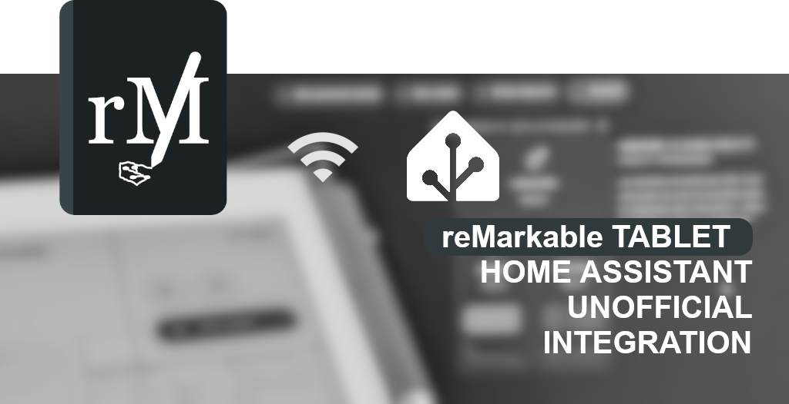
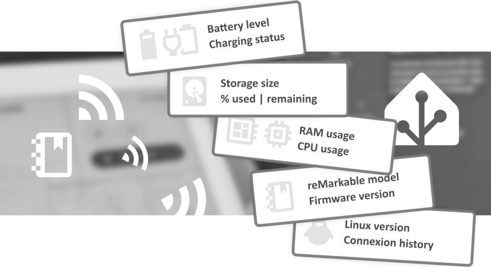
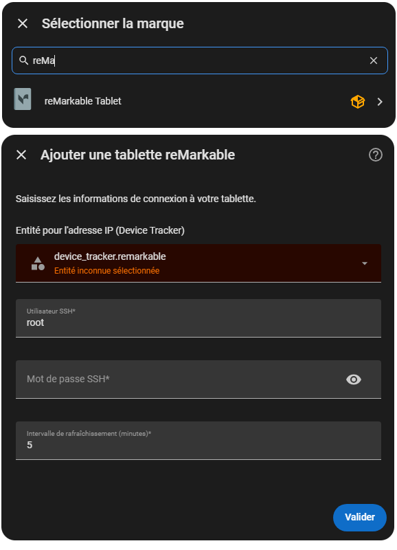
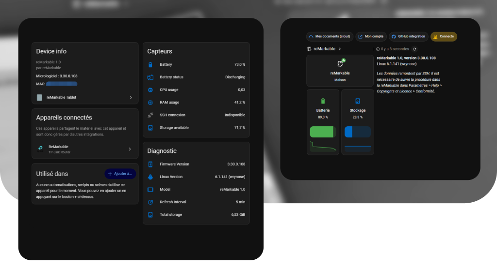

[](https://remarkable.com/products/remarkable-1)
[](https://remarkable.com/products/remarkable-2)
[](https://remarkable.com/products/remarkable-paper/pro)
[](https://remarkable.com/products/remarkable-paper/pro-move)
[](https://remarkable.com/products/remarkable-paper/pure)
[](https://discord.gg/ATqQGfu)
&nbsp;  
  
  


# reMarkable status, Home Assistant unofficial integration



<div style="max-width:1024px; padding: 8px 20px; background-color: rgba(127,127,127,0.1);">

Home Assistant integration to track your reMarkable tablet status.  
Developped by Aurélien Tomassini (ooree23).  
**This is a custom integration, not official, nor related to reMarkable team.  
Please ensure to read the Caution section !**


Tested with reMarkable 1, on Home Assistant 2026.11.0.

</div>

<!-- toc -->

- [Features](#features)
- [Caution](#caution)
- [Installation](#installation)
  * [Requirements](#requirements)
  * [Adding your reMarkable(s)](#adding-your-remarkables)
- [Trigger](#trigger)
- [Devices, sensors, dashboard](#devices-sensors-dashboard)

<!-- tocstop -->

## Features



- display connexion history chart
- see the battery evolution chart over the week,
  create notification when battery is low,
  notify when the battery fully charged...
- see the storage evolution chart over time,
  notify when storage remaining is low, etc
- ...and whatever you can imagine with all those sensors !  
   


## Caution

> [!CAUTION]
> This integration connects to your reMarkable using an SSH connection.  
> All the SSH commands used are in [ssh_commands.py](custom_components/remarkable/ssh_commands.py).  
> When using a fork (or even my version), please ensure to be aware of which command is used, to ensure that the integration doesn't modify any data on your reMarkable.  
> **Use it at your own risk.**

> [!TIP]
> Every single command in this integration is read-only:
> - reading file `/sys/class/power_supply/` for battery information
> - using read command `df` for storage information
> - using read command `free` for RAM information
> - reading file `/proc/loadavg` for CPU information
> - reading file `/etc/os-release` for OS and firmware information
> - reading file `/sys/devices/soc0/machine` for device information

## Installation

Search for `"reMarkable"` in HACS / Home Assistant Marketplace, since this repository has been approved since Novembre 17th 2026 by HACS administrators,
or simply click on this button :

[](https://my.home-assistant.io/redirect/marketplace_repository/?owner=ooree23&repository=HomeAssistantReMarkable&category=integration)

### Requirements

> The 3 items here are all required.

- Your reMarkable **must be** in the same network as your Home Assistant
- A `device_tracker` entity that has the IP address of your reMarkable as **a "ip" attribute**.  
  It allows to use a dynamic IP address for your reMarkable, usually thanks to your router
  integration.  
  > If you have no device_tracker to find the IP from, you can force static IP for your reMarkable on your routeur.  
  > In this case, you can create a virtual `device_tracker` in your `configuration.yaml`, containing this static IP address.
  > ```yaml
  > template:
  >   - device_tracker:
  >       - name: "My rM tracker with static IP"
  >         unique_id: my_remarkable_virtual_tracker
  >         in_zones: "{{ ['zone.home'] }}" 
  >         attributes:
  >           ip: "192.168.1.50"
  >           mac: "AA:BB:CC:DD:EE:FF"
  > ```
- The **SSH over Wifi must be enabled** (disabled by default).   
  If not enabled yet, go to `Settings` > `Help` > `Copyright...` > Conformity section.  
  It gives you the SSH login/password, and the command to enable it in Wifi.  
  Once allowed, your reMarkable will be accessible by Home Assistant over Wifi,
  every time it is connected to your local network.

### Adding your reMarkable(s)

> You can add as many reMarkable tablets as you want.  
> Each of them must have its own `device_tracker`.

- Add new integration, and search for reMarkable (or use the below button)<br><br>
  [](https://my.home-assistant.io/redirect/config_flow_start/?domain=remarkable)<br><br>
- Fill out the form :
  - select the `device_tracker` targeting this new reMarkable (cf above explanation)
  - fill the reMarkable SSH username and password  
    

## Trigger

- Data is refreshed every time the `device_tracker` changes (connexion state or IP)
- Data is also refreshed every 5 minutes by default (interval customizable)

## Devices, sensors, dashboard

> Your known reMarkable tablets will be listed here :
> 
> [](https://my.home-assistant.io/redirect/integration/?domain=remarkable) or here [](https://my.home-assistant.io/redirect/devices/?domain=remarkable)

<div style="max-width:1024px; padding: 8px 20px; background-color: rgba(127,127,127,0.1);">

You can see the below examples of a device details, showing its sensors, and a dashboard example using those sensors.

</div>




