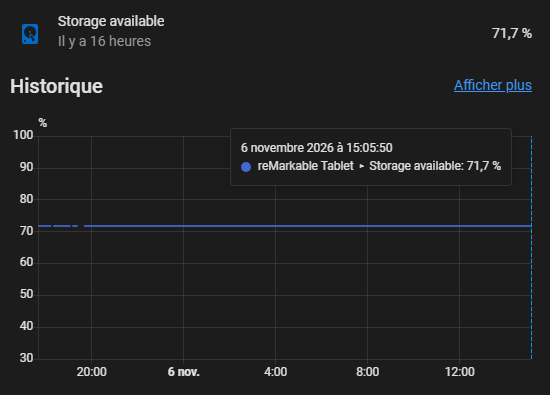
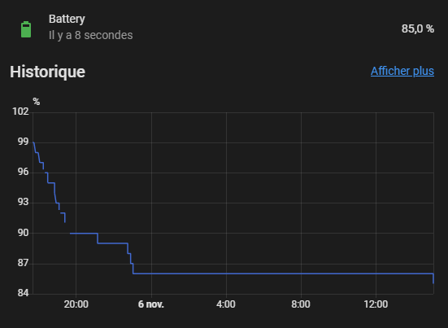

[](https://remarkable.com/products/remarkable-1)
[](https://remarkable.com/products/remarkable-2)
[](https://remarkable.com/products/remarkable-paper/pro)
[](https://remarkable.com/products/remarkable-paper/pro-move)
[](https://remarkable.com/products/remarkable-paper/pure)
[](https://discord.gg/ATqQGfu)
&nbsp;  
  
  


# reMarkable status, Home Assistant unofficial integration


Home Assistant integration to track your reMarkable tablet status.  
Developped by Aurélien Tomassini (ooree23).  
**This is a custom integration, not official, nor related to reMarkable team.  
Please ensure to read the Caution section !**


Tested with reMarkable 1, on Home Assistant 2026.11.0.

<!-- toc -->

- [Features](#features)
  * [Use cases](#use-cases)
- [Caution](#caution)
- [Installation](#installation)
  * [Requirements](#requirements)
  * [Adding your reMarkable(s)](#adding-your-remarkables)
- [Triggers](#triggers)
- [Devices, sensors, dashboard](#devices-sensors-dashboard)

<!-- tocstop -->

## Features


### Use cases

- Display connexion history chart to know when your reMakable is used, how long
- See the battery evolution chart over the time
- Notify when battery is low
- Notify when the battery is fully charged
- See the storage evolution chart over time
- Notify when storage remaining is low
- ... and whatever you can imagine with all the sensors !  

   


## Caution

> [!CAUTION]
> This integration connects to your reMarkable using an SSH connection.  
> All the SSH commands used are in [ssh_commands.py](custom_components/remarkable/ssh_commands.py).  
> When using a fork (or even my version), please ensure to be aware of which command is used, to ensure that the integration doesn't modify any data on your reMarkable.  
> **Use it at your own risk.**

> [!TIP]
> Every single command in this integration is read-only:
> - reading file `/sys/class/power_supply/` for battery information
> - using read command `df` for storage information
> - using read command `free` for RAM information
> - reading file `/proc/loadavg` for CPU information
> - reading file `/etc/os-release` for OS and firmware information
> - reading file `/sys/devices/soc0/machine` for device information

## Installation

Search for `"reMarkable"` in HACS / Home Assistant Marketplace,  
since this repository has been approved since Novembre 17th 2026 by HACS administrators,  
or simply click on this button :

[](https://my.home-assistant.io/redirect/marketplace_repository/?owner=ooree23&repository=HomeAssistantReMarkable&category=integration)

### Requirements

> The 3 items here are all required.

1. Your reMarkable **must be** in the same network as your Home Assistant
2. A `device_tracker` entity that has the IP address of your reMarkable as **a "ip" attribute**.  
   It allows to use a dynamic IP address for your reMarkable, usually thanks to your router
   integration.  
   > If you have no device_tracker to find the IP from, you can force static IP for your reMarkable on your routeur.  
   > In this case, you can create a virtual `device_tracker` in your `configuration.yaml`, containing this static IP address.
   > ```yaml
   > template:
   >   - device_tracker:
   >       - name: "My rM tracker with static IP"
   >         unique_id: my_remarkable_virtual_tracker
   >         in_zones: "{{ ['zone.home'] }}" 
   >         attributes:
   >           ip: "192.168.1.50"
   >           mac: "AA:BB:CC:DD:EE:FF"
   > ```
3. The **SSH over Wifi must be enabled** (disabled by default).   
  If not enabled yet, go to `Settings` > `Help` > `Copyright...` > Conformity section.  
  It gives you the SSH login/password, and the command to enable it in Wifi.  
  Once allowed, your reMarkable will be accessible by Home Assistant over Wifi,
  every time it is connected to your local network.

### Adding your reMarkable(s)

> You can add as many reMarkable tablets as you want.  
> Each of them must have its own `device_tracker`.

1. Add new integration, and search for reMarkable,  
  or simply use the below button :<br><br>
  [](https://my.home-assistant.io/redirect/config_flow_start/?domain=remarkable)<br><br>
2. Fill out the form :
   - select the `device_tracker` targeting this new reMarkable (cf above explanation)
   - fill the reMarkable SSH username and password  
   

## Triggers

> The reMarkable status is requested using two rules :
> 1. Data is refreshed every time the `device_tracker` changes (connexion state or IP).  
>    It means that when your tracker goes from `disconnected` to `connected` (your router just
>    discovered the reMarkable on WiFi), Home Assistant will ask for its status.
> 2. As long as the reMarkable is `connected`, data is also refreshed every 5 minutes, by default.  
>    To avoid battery dropping by those requests, you can change the default interval to whatever you want (in the above setting screen).  
>    Lower intervals will consume more battery.

## Devices, sensors, dashboard

> Your known reMarkable tablets will be listed here :
> 
> [](https://my.home-assistant.io/redirect/integration/?domain=remarkable) or here [](https://my.home-assistant.io/redirect/devices/?domain=remarkable)


You can see the below examples of a device details, showing its sensors, and a dashboard example using those sensors.


