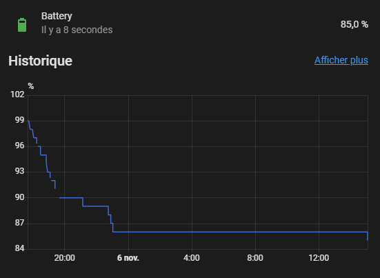
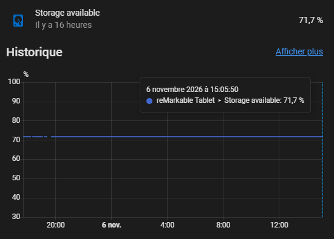
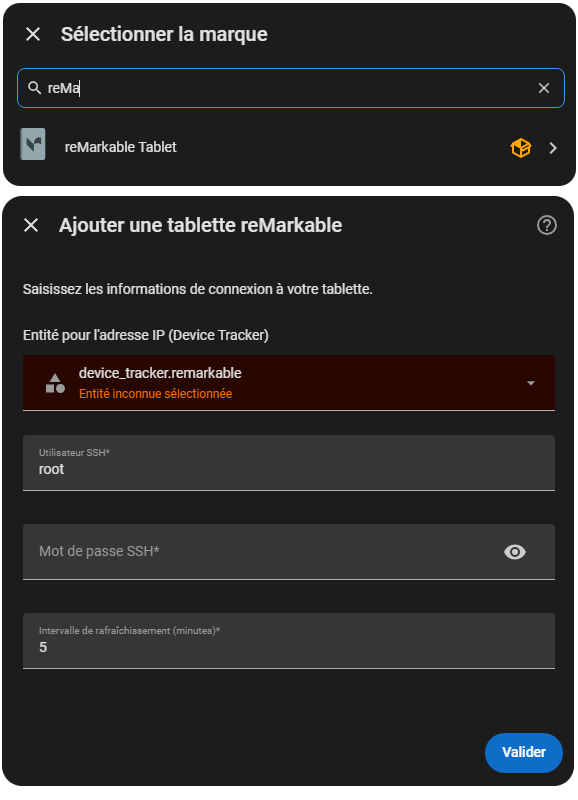
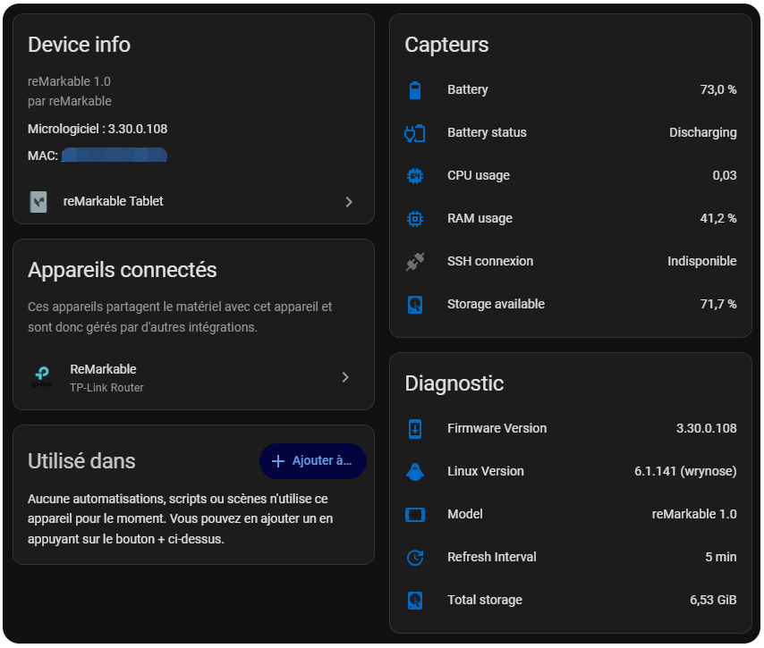
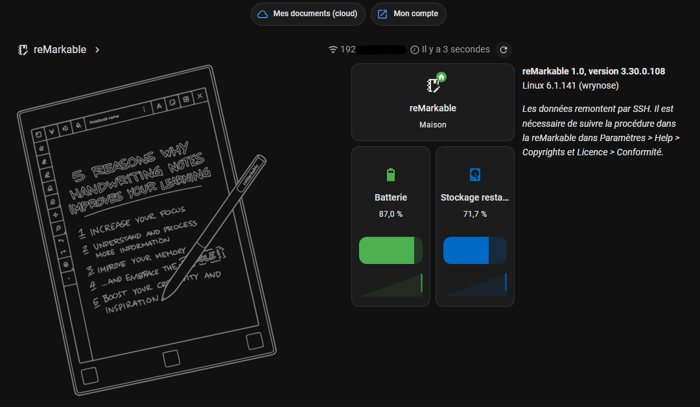

  
  
[](https://my.home-assistant.io/redirect/marketplace_repository/?owner=ooree23&repository=HomeAssistantReMarkable&category=integration)


# reMarkable status unofficial Home Assistant integration


Home Assistant integration to track your reMarkable tablet status.  
Developped by Aurélien Tomassini (ooree23).  
This is a custom integration, not official, nor related to reMarkable team.

Tested with reMarkable 1, on Home Assistant 2026.11.0.

<!-- toc -->

- [Features](#features)
- [Installation](#installation)
  * [Requirements](#requirements)
  * [Adding your reMarkable(s)](#adding-your-remarkables)
- [Trigger](#trigger)
- [Sensors](#sensors)
  * [Device example](#device-example)
  * [Dashboard example](#dashboard-example)

<!-- tocstop -->

## Features

Track your reMarkable info :
- **Battery** sensor :  
  you can then see its evolution over the week,  
  create notification when battery is low,  
  notify when the battery fully charged...  
  
- **Storage** usage sensor :  
  see the storage evolution over time,  
  notify when storage remaining is low, etc  
  
- **CPU** usage sensor
- **RAM** usage sensor
- **Firmware** version
- **Linux** version
- **Model**
- Connexion history
  

## Installation

[](https://my.home-assistant.io/redirect/marketplace_repository/?owner=ooree23&repository=HomeAssistantReMarkable&category=integration)

### Requirements

- Your reMarkable **must be** in the same network as your Home Assistant
- A `device_tracker` entity that has the IP address of your reMarkable as **a "ip" attribute**.  
  It allows to use a dynamic IP address for your reMarkable, usually thanks to your router
  integration.  
  > If you have no device_tracker to find the IP from, you can force static IP for your reMarkable on your routeur.  
  > In this case, you can create a virtual `device_tracker` containing this static IP address.
  > ```yaml
  > template:
  >   - device_tracker:
  >       - name: "My rM tracker with static IP"
  >         unique_id: my_remarkable_virtual_tracker
  >         in_zones: "{{ ['zone.home'] }}" 
  >         attributes:
  >           ip: "192.168.1.50"
  >           mac: "AA:BB:CC:DD:EE:FF"
  > ```
- The **SSH over Wifi must be enabled** (disabled by default).   
  If not enabled yet, go to `Settings` > `Help` > `Copyright...` > Conformity section.  
  It gives you the SSH login/password, and the command to enable it in Wifi.  
  Once allowed, your reMarkable will be accessible by Home Assistant over Wifi,
  every time it is connected to your local network.

### Adding your reMarkable(s)

> You can add as many reMarkable tablets as you want.  
> Each of them must have its own `device_tracker`.

- Add new integration, and search for reMarkable
- Fill the form :
  - select the `device_tracker` targeting this new reMarkable (cf above explanation)
  - fill username and password  
  

## Trigger
- Data is refreshed every time the `device_tracker` changes (state or IP)
- Data is also refreshed every 5 minutes by default (interval customizable)

## Sensors

### Device example



### Dashboard example

